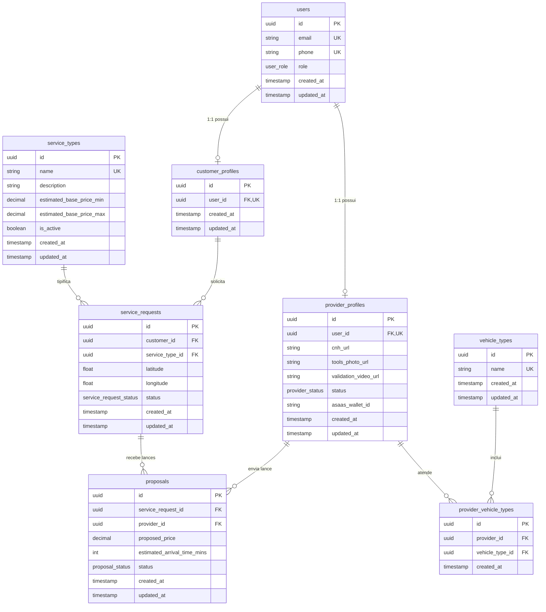
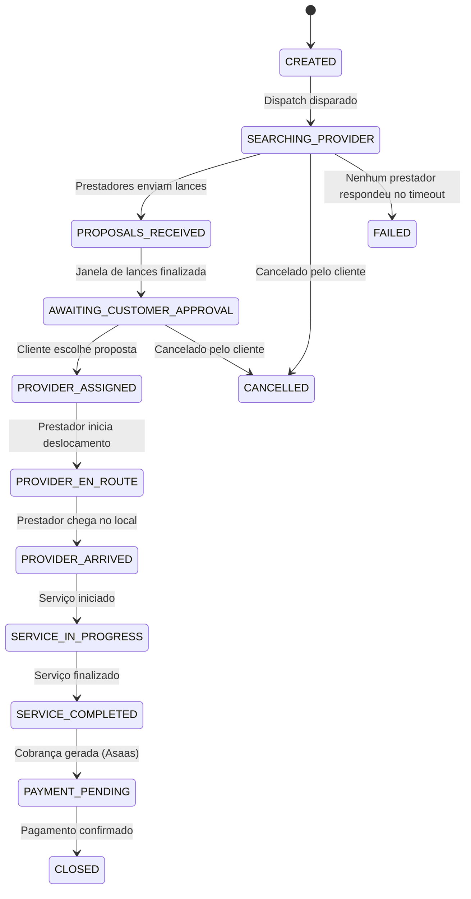
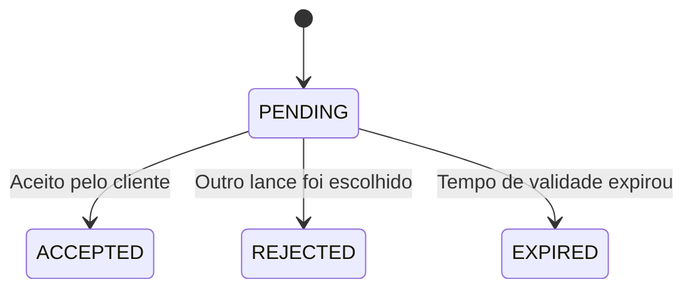

# Modelo de Dados - BorracharIA

## 1. Princípios Arquiteturais do Schema

- **Identificadores UUIDv4**: Nenhuma tabela utiliza inteiros auto-incrementados. Todas as chaves primárias são tipadas como `UUID` geradas via `gen_random_uuid()` para prevenir enumeração maliciosa de registros.
- **Separação Estrita de Perfis**: A entidade `User` atua como âncora de autenticação e identidade, enquanto `CustomerProfile` e `ProviderProfile` mantêm o isolamento de domínio 1:1.
- **Onboarding Resiliente de Prestadores**: URLs de documentos de validação (`cnh_url`, `tools_photo_url`, `validation_video_url`) são concebidas como `nullable`, permitindo que o prestador inicie o cadastro e complete o upload assíncrono durante sua jornada de credenciamento.
- **Prontidão de Integração Asaas**: O campo `asaas_wallet_id` em `ProviderProfile` prepara a liquidação de repasses e subcontas no gateway Asaas.
- **Especialização de Veículos N:M**: Relação de muitos para muitos entre `ProviderProfile` e `VehicleType` com chave primária UUID dedicada na tabela associativa `provider_vehicle_types`.
- **Precisão Financeira Estrita (Decimal)**: Valores monetários em `ServiceType` (`estimated_base_price_min`, `estimated_base_price_max`) e `Proposal` (`proposed_price`) utilizam o tipo `Decimal(10,2)` para prevenir erros de ponto flutuante em liquidações e repasses.
- **Mecânica de Lances e Precificação Dinâmica (Wave 3)**: O cliente solicita o atendimento gerando um `ServiceRequest`. Os profissionais nas proximidades enviam `Proposal` contendo preço proposto e tempo estimado de chegada (`estimated_arrival_time_mins`).
- **Tratamento Geoespacial no Prisma (PostGIS)**: Coordenadas de solicitação (`latitude`, `longitude`) são tipadas como `Float` no modelo para serialização nativa de alta performance e compatibilidade com APIs do cliente (PWAs / Leaflet / Mapbox), enquanto o motor PostgreSQL/PostGIS subjacente viabiliza funções espaciais como `ST_DistanceSphere` e índices `GIST` em queries analíticas de proximidade.

## 2. Diagrama Entidade-Relacionamento (ERD)

## 3. Máquina de Estados Operacional

### 3.1. ServiceRequestStatus

### 3.2. ProposalStatus

---

## 4. Dicionário de Dados

### 4.1. users

| Campo        | Tipo        | Nulo | Padrão              | Descrição                                         |
| :----------- | :---------- | :--- | :------------------ | :------------------------------------------------ |
| `id`         | UUID        | Não  | `gen_random_uuid()` | Chave primária universal                          |
| `email`      | VARCHAR     | Não  | -                   | E-mail do usuário (único)                         |
| `phone`      | VARCHAR     | Não  | -                   | Telefone com DDD (único)                          |
| `role`       | `user_role` | Não  | `CUSTOMER`          | Perfil de acesso: `CUSTOMER`, `PROVIDER`, `ADMIN` |
| `created_at` | TIMESTAMP   | Não  | `now()`             | Data/hora de criação do registro                  |
| `updated_at` | TIMESTAMP   | Não  | -                   | Data/hora da última atualização                   |

### 4.2. customer_profiles

| Campo        | Tipo      | Nulo | Padrão              | Descrição                                   |
| :----------- | :-------- | :--- | :------------------ | :------------------------------------------ |
| `id`         | UUID      | Não  | `gen_random_uuid()` | Chave primária                              |
| `user_id`    | UUID      | Não  | -                   | FK para `users.id` (1:1, onDelete: CASCADE) |
| `created_at` | TIMESTAMP | Não  | `now()`             | Criação do perfil                           |
| `updated_at` | TIMESTAMP | Não  | -                   | Última atualização                          |

### 4.3. provider_profiles

| Campo                  | Tipo              | Nulo | Padrão              | Descrição                                           |
| :--------------------- | :---------------- | :--- | :------------------ | :-------------------------------------------------- |
| `id`                   | UUID              | Não  | `gen_random_uuid()` | Chave primária                                      |
| `user_id`              | UUID              | Não  | -                   | FK para `users.id` (1:1, onDelete: CASCADE)         |
| `cnh_url`              | TEXT              | Sim  | NULL                | URL do comprovante da CNH                           |
| `tools_photo_url`      | TEXT              | Sim  | NULL                | URL da foto do kit de ferramentas do borracheiro    |
| `validation_video_url` | TEXT              | Sim  | NULL                | URL do vídeo de validação técnica do prestador      |
| `status`               | `provider_status` | Não  | `PENDING_REVIEW`    | Status: `PENDING_REVIEW`, `APPROVED`, `REJECTED`    |
| `asaas_wallet_id`      | VARCHAR           | Sim  | NULL                | Identificador da subconta/carteira no gateway Asaas |
| `created_at`           | TIMESTAMP         | Não  | `now()`             | Criação do perfil de prestador                      |
| `updated_at`           | TIMESTAMP         | Não  | -                   | Última atualização                                  |

### 4.4. vehicle_types

| Campo        | Tipo      | Nulo | Padrão              | Descrição                                                 |
| :----------- | :-------- | :--- | :------------------ | :-------------------------------------------------------- |
| `id`         | UUID      | Não  | `gen_random_uuid()` | Chave primária                                            |
| `name`       | VARCHAR   | Não  | -                   | Nome da categoria (ex: Moto, Passeio, Caminhão, Agrícola) |
| `created_at` | TIMESTAMP | Não  | `now()`             | Criação                                                   |
| `updated_at` | TIMESTAMP | Não  | -                   | Atualização                                               |

### 4.5. provider_vehicle_types

| Campo             | Tipo      | Nulo | Padrão              | Descrição                                          |
| :---------------- | :-------- | :--- | :------------------ | :------------------------------------------------- |
| `id`              | UUID      | Não  | `gen_random_uuid()` | Chave primária                                     |
| `provider_id`     | UUID      | Não  | -                   | FK para `provider_profiles.id` (onDelete: CASCADE) |
| `vehicle_type_id` | UUID      | Não  | -                   | FK para `vehicle_types.id` (onDelete: CASCADE)     |
| `created_at`      | TIMESTAMP | Não  | `now()`             | Criação da associação                              |

### 4.6. service_types

| Campo                      | Tipo          | Nulo | Padrão              | Descrição                                          |
| :------------------------- | :------------ | :--- | :------------------ | :------------------------------------------------- |
| `id`                       | UUID          | Não  | `gen_random_uuid()` | Chave primária                                     |
| `name`                     | VARCHAR       | Não  | -                   | Nome do serviço (ex: Troca de Pneu, Calibragem)    |
| `description`              | TEXT          | Sim  | NULL                | Descrição detalhada do escopo do serviço           |
| `estimated_base_price_min` | DECIMAL(10,2) | Não  | -                   | Estimativa mínima de preço base                    |
| `estimated_base_price_max` | DECIMAL(10,2) | Não  | -                   | Estimativa máxima de preço base                    |
| `is_active`                | BOOLEAN       | Não  | `true`              | Flag indicando se o serviço está ativo no catálogo |
| `created_at`               | TIMESTAMP     | Não  | `now()`             | Criação do serviço                                 |
| `updated_at`               | TIMESTAMP     | Não  | -                   | Última atualização                                 |

### 4.7. service_requests

| Campo             | Tipo                     | Nulo | Padrão              | Descrição                                          |
| :---------------- | :----------------------- | :--- | :------------------ | :------------------------------------------------- |
| `id`              | UUID                     | Não  | `gen_random_uuid()` | Chave primária                                     |
| `customer_id`     | UUID                     | Não  | -                   | FK para `customer_profiles.id` (onDelete: CASCADE) |
| `service_type_id` | UUID                     | Não  | -                   | FK para `service_types.id` (onDelete: RESTRICT)    |
| `latitude`        | DOUBLE PRECISION         | Não  | -                   | Latitude GPS do chamado de emergência              |
| `longitude`       | DOUBLE PRECISION         | Não  | -                   | Longitude GPS do chamado de emergência             |
| `status`          | `service_request_status` | Não  | `CREATED`           | Estado atual da máquina de estados do chamado      |
| `created_at`      | TIMESTAMP                | Não  | `now()`             | Data/hora de abertura                              |
| `updated_at`      | TIMESTAMP                | Não  | -                   | Data/hora da última alteração de status            |

### 4.8. proposals

| Campo                         | Tipo              | Nulo | Padrão              | Descrição                                                         |
| :---------------------------- | :---------------- | :--- | :------------------ | :---------------------------------------------------------------- |
| `id`                          | UUID              | Não  | `gen_random_uuid()` | Chave primária                                                    |
| `service_request_id`          | UUID              | Não  | -                   | FK para `service_requests.id` (onDelete: CASCADE)                 |
| `provider_id`                 | UUID              | Não  | -                   | FK para `provider_profiles.id` (onDelete: CASCADE)                |
| `proposed_price`              | DECIMAL(10,2)     | Não  | -                   | Preço proposto pelo prestador (precisão financeira)               |
| `estimated_arrival_time_mins` | INTEGER           | Não  | -                   | Tempo estimado para chegada no local em minutos                   |
| `status`                      | `proposal_status` | Não  | `PENDING`           | Estado da proposta (`PENDING`, `ACCEPTED`, `REJECTED`, `EXPIRED`) |
| `created_at`                  | TIMESTAMP         | Não  | `now()`             | Envio da proposta                                                 |
| `updated_at`                  | TIMESTAMP         | Não  | -                   | Última atualização                                                |
